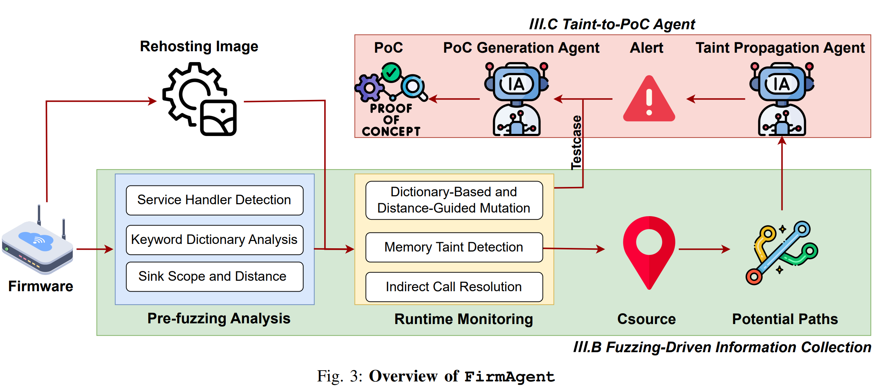

# FirmAgent

**⚠️ Legal/Ethical Notice**
Only test targets you own or have explicit written permission to assess. You are solely responsible for compliance with local laws, licenses, and organizational policies.

------

## Table of Contents

- [Overview](#overview)

- [Prerequisites](#prerequisites)

- [Quick Start](#quick-start)

- [Workflow](#workflow)

  - [1) Pre-fuzzing Analysis](#1-pre-fuzzing-analysis)
  - [2) Runtime Monitoring](#2-runtime-monitoring)
  - [3) Fuzzing](#3-fuzzing)
  - [4) Taint-to-PoC Agent](#4-taint-to-poc-agent)

- [Input/Output Schemas](#inputoutput-schemas)

  - [Pre_fuzzing.json](#pre_fuzzingjson-api-definitions)
  - [Fuzzing output files](#fuzzing-output-files)

- [Configuration Reference](#configuration-reference)

- [Tips & Best Practices](#tips--best-practices)

- [Troubleshooting](#troubleshooting)

- [FAQ](#faq)

  

------

## Overview

This toolkit automates an end-to-end workflow for discovering and validating vulnerabilities in re-hosted IoT firmware:

1. **Fuzzing-Driven Information Collection**

   - Extract all target URIs and input parameters.
   - Locate sink functions and compute distances from basic blocks to sinks.
   - Produce mutation dictionaries for the fuzzer.

   - Instrumented QEMU binaries collect control-flow data during fuzzing.
   - Optional: Build emulation images directly with a helper script.

   - Generic, device-aware API fuzzer with configurable `Host` header.
   - Uses the pre-fuzzing artifacts to generate requests and mutations.

2. **Taint-to-PoC Agent**

   - LLM-assisted taint analysis to findings vulnerabilities and produce PoCs.


------

## Prerequisites

- **Python**: 3.8+
   Install Python dependencies:

  ```
  pip install -r requirements.txt
  ```

- **Emulation**: Greenhouse (Details can be found in https://github.com/sefcom/greenhouse.git)

  - We ship instrumented binaries under `FirmAgent/FuzzingRecord/gh3fuzz/fuzz_bins/qemu/`.
  - Control-flow collector: `libibresolver.so`.

- **Target firmware**: Obtain and re-host the firmware image 

- **Setting Environment Variables:**

  export IDAT_BIN=/path/to/idat64

  export Private_API_KEY={API_KEY}
  # Optional: override the provider endpoint/model used by both LLM stages.
  export LLM_BASE_URL=https://api.deepseek.com/chat/completions
  export LLM_MODEL=deepseek-reasoner

------


## Quick Start

1. **Run pre-fuzzing** (single command):

  Simply run the automated pipeline script:

  ```
  ./Pre_Fuzzing/run.sh <target_binary>
  ```

  This single command will:
  - Export decompiled code and strings from IDA Pro
  - Extract API endpoints and parameters using LLM
  - Identify sink function address ranges
  - Compute distances from basic blocks to sinks

  **Outputs** (in the same directory as `<target_binary>`):
  - `Pre_fuzzing.json` - Complete fuzzing input schema with APIs and parameters
  - `sink_scope_addr.txt` - Sink function address ranges
  - `sink_distance_scores.json` / `sink_distance_scores.csv` - Distance scores for prioritization
  - `export-for-ai-<binary_name>/` - Decompiled evidence directory

2. **Build an emulated image (optional, automated wiring)**:

```
python build_fuzz_img.py
```

This integrates the instrumentation and supporting binaries into the emulation image.

2. **Start the re-hosted web service, then fuzz from the host** (no in-container fuzzing):

  **⚠️ Important:** Before running the fuzzer, customize the request templates in `FuzzingRecord/Fuzzer.py` to match your target device's API format.

  ```bash
  # Step 1 — start the web service inside the Greenhouse container under
  # instrumented QEMU (background chain + setup + taint tracing, no fuzzing):
  ./FuzzingRecord/start_rehost.sh \
    --container {container_name} \
    --dfilter "0x405538..0x4059D8,0x406808..0x433EE8"   # from sink_scope_addr.txt

  # The container needs a shared volume so the host can read the trace log:
  #   docker run -d --name {container_name} -v /host/shared:/scratch {image} ...

  # Step 2 — start the taint monitor sidecar (host)
  python FuzzingRecord/taint_monitor.py \
    --stream result_stream.ndjson \
    --qemu-log /host/shared/qemu_trace.log \
    --out trace_windows.jsonl

  # Step 3 — fuzz from the host with Fuzzer.py
  python FuzzingRecord/Fuzzer.py \
    --json-file Pre_fuzzing.json \
    --delay 0.5 \
    --host {container_ip} \
    --tag-mode unique
  ```

  `start_rehost.sh` waits until the service answers HTTP, then prints these
  next-step commands with the real container IP filled in.

  **Fuzzing outputs:**
  - `result.json` — Request packets and responses
  - `result_stream.ndjson` — Per-request stream (with `--tag-mode unique`)
  - `trace_windows.jsonl` — Byte-window attribution from `taint_monitor.py`

3. **Generate Source.json and run LLM-assisted taint analysis**:

  Convert the QEMU taint log into `Source.json` (place it in the same folder as the target binary), then run:

  ```
  # Exact join (recommended, requires --tag-mode unique + taint_monitor.py)
  python FuzzingRecord/build_source_json.py \
    --qemu-log /path/to/qemu_trace.log \
    --windows trace_windows.jsonl \
    --result-stream result_stream.ndjson \
    --output Source.json

  # Or legacy heuristic (no per-request attribution)
  python FuzzingRecord/build_source_json.py \
    --qemu-log /path/to/qemu_trace.log \
    --format sources \
    --result-json result.json \
    --output Source.json
  ```

  Then run the taint analysis agent:

  ```
  python LLMATaint.py \
    -b {path_to_binary} \
    -p {True|False} \
    -t {vuln_type} \
    -o {path_to_resultfolder}
  ```

  Configure the endpoint and model with `LLM_BASE_URL` and `LLM_MODEL`. The optional legacy `-m R1_official|V3_official` flag only selects a fallback when `LLM_MODEL` is unset.

  The taint analysis agent will:
  - Analyze the taint flow from source points identified during fuzzing
  - Use the reachable test cases as base request packets during later validation / PoC generation
  - First determine whether an alert exists, then validate it and generate concrete PoCs

------

## Workflow

### 1) Pre-fuzzing Analysis

**Goal:** Collect everything needed to drive effective mutations and triage.

The pre-fuzzing pipeline (`Pre_Fuzzing/run.sh`) automates the following steps:

1. **Decompilation export** (`Pre_Fuzzing/decompile.py`)
   - Exports decompiled functions, strings, memory dumps, imports/exports
   - Creates `export-for-ai-<binary_name>/` directory with all evidence

2. **API & parameter extraction** (`Pre_Fuzzing/llm_extract_api_params.py`)
   - Uses LLM to analyze decompiled code and extract:
     - API endpoints (goform handlers, URL routes, etc.)
     - Parameter names and types from function callsites
   - Generates `Pre_fuzzing.json` with complete fuzzing schema

3. **Sink scope extraction** (`Pre_Fuzzing/Get_SinkFunc.py`)
   - Identifies dangerous sink functions (system calls, strcpy, etc.)
   - Traces backward from sinks to find all reachable functions
   - Outputs `sink_scope_addr.txt` with address ranges

4. **Distance calculation** (`Pre_Fuzzing/Distance.py`)
   - Computes shortest path distances from basic blocks to sinks
   - Prioritizes fuzzing targets closer to dangerous sinks
   - Outputs `sink_distance_scores.json` / `sink_distance_scores.csv`

**Outputs:**

- `Pre_fuzzing.json` - Complete fuzzing input schema (APIs + parameters)
- `sink_scope_addr.txt` - Sink function address ranges
- `sink_distance_scores.json` / `sink_distance_scores.csv` - Distance scores for prioritization

### 2) Runtime Monitoring

We provide an instrumented QEMU stack and a control-flow recording library:

- **Location:**
   `FirmAgent/FuzzingRecord/gh3fuzz/fuzz_bins/qemu/`
  - `libibresolver.so` collects control-flow events.
- **Recommended path:**
  - Use `build_fuzz_img.py` to assemble the emulation image.
  - Instrumentation and collectors are automatically integrated.
- **Customization:**
   You can extend `qemuafl` to log additional runtime signals.
   We provide our **Fuzzing-SA** source for reference (see repo).

#### QEMU launch and environment variables

The supported workflow starts only the **web service** inside the container — there is no in-container fuzzing; all fuzzing is done from the host by `Fuzzer.py`. Use the provided launcher:

```bash
# Container must expose a shared volume for the trace log, e.g.:
docker run -d --name {container_name} -v /host/shared:/scratch {image} ...

./FuzzingRecord/start_rehost.sh --container {container_name} \
  --dfilter "0x405538..0x4059D8,0x406808..0x433EE8"
```

The script runs the container's background chain (`/run_background.sh`) and setup (`/run_setup.sh`) if present, starts the service under instrumented QEMU with taint tracing to `/scratch/qemu_trace.log`, waits for the service to answer HTTP, and prints the host-side next-step commands. All paths and commands have CLI overrides — see `--help`.

Under the hood it sets these QEMU environment variables:

| Variable | Purpose |
|---|---|
| `QEMU_DFILTER` | Comma-separated hex address ranges (e.g. `0x405538..0x4059D8,0x406808..0x433EE8`). Only basic blocks within these ranges emit trace lines. **Required** — without it the trace log grows unboundedly. Set inside the container. |
| `QEMU_LOG` | QEMU log flags. Use `exec,nochain` to emit one line per translated block (default trace format). |
| `QEMU_LOG_FILENAME` | Redirect QEMU log to a file instead of stderr. |

**MIPS BE manual equivalent** (what the script does, TEW-632BRP example):

```bash
# Inside the Docker container:
export QEMU_DFILTER="0x405538..0x4059D8,0x406808..0x433EE8"
export QEMU_LOG=exec,nochain
export QEMU_LOG_FILENAME=/scratch/qemu_trace.log

# Launch the web server with instrumented QEMU:
/qemu-mips-static -hackbind -hackproc -hacksysinfo \
  -execve "/qemu-mips-static -hackbind -hackproc -hacksysinfo" \
  -E LD_PRELOAD="libnvram-faker.so" /sbin/httpd
```

> **Tip:** Derive `QEMU_DFILTER` ranges from `sink_scope_addr.txt` (output of Pre-Fuzzing step 3). Keep the total string under ~4 KB — very long ranges may prevent the binary from starting.

#### Taint monitor (for exact join)

Run the taint monitor sidecar **before** fuzzing so each trace window is attributed to its originating request:

```bash
# Terminal 1: start the monitor (tail the QEMU log via the shared volume)
python FuzzingRecord/taint_monitor.py \
  --stream result_stream.ndjson \
  --qemu-log /host/shared/qemu_trace.log \
  --settle 0.3 \
  --out trace_windows.jsonl

# Terminal 2: start the fuzzer with unique tag mode
python FuzzingRecord/Fuzzer.py --json-file Pre_fuzzing.json \
  --host 192.168.0.1 --tag-mode unique
```

The monitor writes `trace_windows.jsonl` — one JSON line per fuzzer request, recording the byte window `[byte_start, byte_end)` in the QEMU log that corresponds to that request's execution.

### 3) Fuzzing

**⚠️ Before running:** Customize `FuzzingRecord/Fuzzer.py` to match your target device's API format:
- Update request headers (authentication tokens, cookies, etc.)
- Adjust payload structure if your device uses non-standard formats
- Configure device-specific error detection patterns
- Have the service running via `start_rehost.sh` (it sets `QEMU_DFILTER` inside the container — see §Runtime Monitoring above)
- Use `TAINTTAG` as the one-shot parameter seed value

Run the generic fuzzer against your re-hosted device:

```
python FuzzingRecord/Fuzzer.py \
  --json-file Pre_fuzzing.json \
  --delay 0.5 \
  --host {target_ip_or_domain}
```

- `--json-file` — Pre-fuzzing output containing API definitions.
- `--delay` — Inter-request sleep to avoid rate-limits / WAFs.
- `--host` — Value for the `Host` header (supports SNI / vhosts).
- `--tag-mode` — `constant` (default): every request uses the same `TAINTTAG` seed; `unique`: injects `{TAG}_{seq}` per request for precise attribution (requires `taint_monitor.py` sidecar).

**What happens:**

- The fuzzer parses `Pre_fuzzing.json` and parameter templates.
- For each endpoint & parameter, it generates mutations.
- Requests and responses are logged to `fuzzing_results.log`.
- Structured request/response packets are written to `result.json` next to the input JSON.
- When `--tag-mode unique`, a streaming `result_stream.ndjson` is also written (one JSON line per request, with `request_id`, `sent_at`, etc.).
- Potential vulnerabilities are flagged based on error codes, timing, and content indicators.

**Fuzzing outputs:**

- `result.json` — Structured request packets and responses written by `FuzzingRecord/Fuzzer.py`
- `result_stream.ndjson` — Per-request stream (only with `--tag-mode unique`); consumed by `taint_monitor.py`
- `fuzzing_results.log` — Human-readable progress and warnings

### 4) Taint-to-PoC Agent

Once fuzzing identifies source points and generates test cases, use LLM-assisted taint analysis to validate and transform findings into concrete PoCs:

```
python LLMATaint.py \
  -b {path_to_binary} \
  -p {True|False} \
  -t {vuln_type} \
  -o {path_to_resultfolder}
```

Set `LLM_BASE_URL` and `LLM_MODEL` before running the command.

**Prerequisites:**
- Place `Source.json` or `source.json` (contains source addresses and reachable test cases) in the **same directory** as the target binary
- If available, place `Indirect_call.json` or `indirect_data.json` (caller-callee pairs) in the same directory

**What the agent does:**

- Analyzes taint flow from source points identified during fuzzing
- Uses reachable test cases from `Source.json` / `source.json` as base packets during later PoC generation
- Traces data flow through decompiled code to identify vulnerable paths
- Uses a two-stage process: first taint/alert judgment, then validation + PoC generation
- Produces validated exploit code with proper input formatting

------

## Input/Output Schemas

### Pre_fuzzing.json (API definitions)

Preferred format used by the current `FuzzingRecord/Fuzzer.py`:

```
{
  "api_endpoints": [
    "/nitro/v1/config/example_endpoint",
    "/apply.cgi"
  ],
  "para": [
    "username",
    "cmd",
    "action"
  ]
}
```

Legacy array-of-objects input is still partially supported for endpoint extraction, but the current fuzzer primarily expects:

- `api_endpoints`: Relative API paths.
- `para`: Parameter names used to build per-parameter taint payloads.

### Fuzzing output files

- **`fuzzing_results.log`** — Human-readable progress and warnings.
- **`result.json`** — Structured request packets and responses emitted by `FuzzingRecord/Fuzzer.py`.
- **`result_stream.ndjson`** — Per-request stream (only with `--tag-mode unique`); one JSON line per request with `request_id`, `sent_at`, etc.
- **`trace_windows.jsonl`** — Produced by `taint_monitor.py`; maps each request to its byte window in the QEMU log.
- **`Source.json`** — Source addresses and their corresponding reachable test cases (required for taint analysis). Generated by `build_source_json.py` from the QEMU trace log.
- **`Indirect_call.json`** / **`indirect_data.json`** (optional) — Caller-callee pairs for indirect call resolution.

### `Source.json` format and generation

`LLMATaint.py` supports both simple address lists and structured source entries. You can generate either format from runtime taint logs using:

`FuzzingRecord/build_source_json.py`

1) Address-list format (minimal):

```
[
  "0x401000",
  "0x4023a4",
  "0x403000"
]
```

Generate:

```
python FuzzingRecord/build_source_json.py \
  --qemu-log /scratch/output/qemu_taint.log \
  --format address-list \
  --output /scratch/output/Source.json
```

2) Structured format with reachable testcases — heuristic (legacy):

```
python FuzzingRecord/build_source_json.py \
  --qemu-log /scratch/output/qemu_taint.log \
  --format sources \
  --result-json /scratch/output/result.json \
  --taint-tag TAINTTAG \
  --output /scratch/output/Source.json
```

This uses the `first` or `round-robin` strategy to attach testcases — no per-request attribution.

3) Structured format with exact join (recommended):

When you ran the fuzzer with `--tag-mode unique` and collected `trace_windows.jsonl` via `taint_monitor.py`:

```
python FuzzingRecord/build_source_json.py \
  --qemu-log /path/to/qemu_trace.log \
  --windows trace_windows.jsonl \
  --result-stream result_stream.ndjson \
  --format sources \
  --output /path/to/Source.json
```

This produces exact per-address attribution:

```
{
  "sources": [
    {
      "address": "0x40565c",
      "reachable_testcase": {
        "api_url": "/login.cgi",
        "method": "POST",
        "post_payload": "user=admin&pass=TAINTTAG_7"
      },
      "observed_in_requests": [7, 15]
    }
  ]
}
```

- `reachable_testcase` comes from the first request that observed taint at this address.
- `observed_in_requests` lists all request IDs whose trace windows contained this address.

Notes:
- `--qemu-log` should point to the log file generated by your instrumented QEMU run.
- If both `Source.json` and `source.json` exist, explicitly set `--dynamic-source-file` when running `LLMATaint.py`.
- Without `--windows`, the script falls back to the legacy heuristic and prints a warning.

------


### Example Commands Recap

**Run pre-fuzzing (single command):**

```
./Pre_Fuzzing/run.sh /path/to/httpd
```

This generates `Pre_fuzzing.json`, `sink_scope_addr.txt`, and distance scores in the same directory as the binary.

**Start the re-hosted service + fuzz (container start, then 2 host terminals):**

⚠️ Remember to customize `FuzzingRecord/Fuzzer.py` request templates first!

```bash
# One-time — start the web service inside the container (no in-container fuzzing):
./FuzzingRecord/start_rehost.sh \
  --container {container_name} \
  --dfilter "0x405538..0x4059D8,0x406808..0x433EE8"

# Terminal 1 — Host: start the taint monitor sidecar (before fuzzing)
python FuzzingRecord/taint_monitor.py \
  --stream result_stream.ndjson \
  --qemu-log /host/shared/qemu_trace.log \
  --settle 0.3 \
  --out trace_windows.jsonl

# Terminal 2 — Host: start the fuzzer (unique tag mode for exact join)
python FuzzingRecord/Fuzzer.py \
  --json-file Pre_fuzzing.json \
  --delay 0.5 \
  --host {container_ip} \
  --tag-mode unique
```

**Build Source.json (exact join):**

```
python FuzzingRecord/build_source_json.py \
  --qemu-log /path/to/qemu_trace.log \
  --windows trace_windows.jsonl \
  --result-stream result_stream.ndjson \
  --output Source.json
```

**Run taint-to-PoC agent:**

Place `Source.json` in the same directory as the binary, then:

```
python LLMATaint.py \
  -b ./bin/httpd \
  -p False \
  -t ci \
  -o ./results/ASUS
```


**Reference**

If you use or cite this work, please reference:

```bibtex
@inproceedings{Ji2026FirmAgent,
  author    = {Ji, Jiangan and Zhang, Chao and Gan, Shuitao and Lin, Jian and Liu, Hangtian and Liu, Tieming and Zheng, Lei and Jia, Zhipeng},
  title     = {FirmAgent: Leveraging Fuzzing to Assist LLM Agents with IoT Firmware Vulnerability Discovery},
  booktitle = {Network and Distributed System Security (NDSS) Symposium},
  year      = {2026},
  month     = {February},
  pages     = {1--16},
  address   = {San Diego, CA, USA},
  doi       = {10.14722/ndss.2026.231943},
  isbn      = {979-8-9919276-8-0},
  url       = {https://dx.doi.org/10.14722/ndss.2026.231943},
}
```


